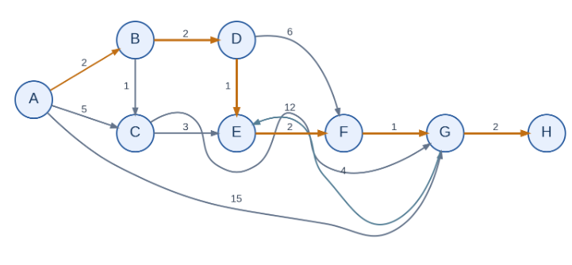
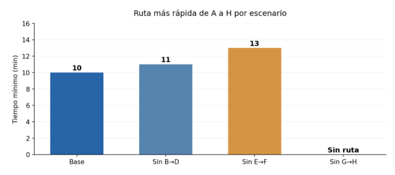

**UNIVERSIDAD PERUANA CAYETANO HEREDIA**

**FACULTAD DE CIENCIAS E INGENIERÍA**

**ESCUELA PROFESIONAL DE INGENIERÍA INFORMÁTICA**

ESTRUCTURAS DISCRETAS II

**TRABAJO ACADÉMICO DE INVESTIGACIÓN**

## Simulación de rutas y análisis de conectividad en redes de transporte mediante grafos dirigidos

AUTORES:

Calva Becerra, Sofia Dayanna

De la Cruz Poma, Ithan Wilmer

Dulanto Aguilar, Nemesis Krystel

Reyes Garcia, Alvaro Pablo

**Tema: 4**

ASESOR:

Dr. Ing. CIP. Illesca Cangalaya, Omar Felix

ORCID: 0000-0002-0144-6878

SAN MARTÍN DE PORRES – PERÚ

2026

Fecha de entrega: 22 / 11 / 2026

---

## ÍNDICE

- Resumen y palabras clave
- I. Introducción
- II. Antecedentes históricos y aportes de autores
- III. Marco teórico
- IV. Objetivos
- V. Metodología y diseño
- VI. Implementación o simulación
- VII. Resultados y análisis
- VIII. Discusión
- IX. Conclusiones
- X. Referencias bibliográficas
- XI. Anexos

**Índice de figuras**

- Figura 1. Red dirigida de estudio y ruta de costo mínimo
- Figura 2. Comparación de tiempos mínimos por escenario
- Figura 3. Evidencias mostrando la fecha y hora en la que fueron realizadas
- Figura 4. Programación de la reunión para culminar detalles
- Figura 5. Reunión programada para validación del código

**Índice de tablas**

- Tabla 1. Conexiones dirigidas y tiempos hipotéticos
- Tabla 2. Plan de pruebas
- Tabla 3. Comparación de algoritmos
- Tabla 4. Resultados de interrupciones

---

# PROYECTO-EDII-RUTAS

## RESUMEN

Esta investigación desarrolla una simulación computacional de rutas y conectividad en grafos dirigidos para representar una red de transporte hipotética. El problema consiste en identificar trayectos factibles y de costo mínimo, así como determinar cómo se modifica el acceso entre puntos cuando se interrumpe una conexión. Se construyó un grafo de ocho vértices y trece aristas orientadas, con pesos no negativos expresados como minutos hipotéticos. Se implementaron en Python, utilizando únicamente su biblioteca estándar, la búsqueda en anchura (BFS), la búsqueda en profundidad (DFS), el algoritmo de Dijkstra y el procedimiento de Kosaraju para componentes fuertemente conexas. Se realizaron comparaciones matemáticas y cuatro escenarios reproducibles: red original y eliminación individual de tres aristas. En la red inicial, BFS obtuvo un recorrido de dos aristas y costo 17, mientras que Dijkstra identificó una ruta de costo 10, lo que evidencia la diferencia entre minimizar saltos y minimizar pesos. La eliminación de una conexión elevó el costo mínimo a 13, mientras que la supresión del único enlace entrante hacia el destino imposibilitó el trayecto. Los resultados respaldan el empleo de grafos dirigidos para estudiar rutas, alcanzabilidad y vulnerabilidad estructural, sin pretender describir el tráfico real de Lima.

**Palabras clave:** grafos dirigidos; rutas mínimas; conectividad; Dijkstra; simulación.

## I. INTRODUCCIÓN

Los sistemas de transporte, comunicación y distribución poseen conexiones que no siempre pueden recorrerse en ambos sentidos. Las calles de sentido único, los enlaces de una red informática y las etapas de una cadena logística son ejemplos de relaciones orientadas. Su representación mediante grafos dirigidos permite formalizar preguntas prácticas: ¿se puede llegar desde un punto de origen hasta un destino?, ¿qué trayecto requiere menos conexiones?, ¿cuál consume menos tiempo?, ¿qué cambia si se bloquea una vía? [1], [2].

Una confusión habitual consiste en equiparar el camino con menos aristas al camino de menor costo. Cuando cada desplazamiento posee un peso diferente —tiempo, distancia o gasto—, ambas respuestas pueden ser distintas. Asimismo, verificar que un destino sea alcanzable desde el origen no significa que exista conectividad en ambos sentidos. La orientación de las aristas obliga a analizar el orden de los recorridos y la conectividad fuerte [1], [3].

Se propone una red de transporte abstracta, diseñada exclusivamente para la experimentación, con ocho ubicaciones rotuladas de A a H. Los pesos representan minutos supuestos y no datos levantados en campo. El alcance comprende la formulación del grafo, la programación de algoritmos básicos, el contraste entre sus respuestas y las pruebas de fallos de aristas; se excluyen congestión temporal, semáforos, capacidad vial y rutas georreferenciadas.

**Pregunta de investigación:** ¿cómo permiten los algoritmos de recorridos y rutas mínimas analizar la alcanzabilidad y la variación del costo de viaje ante interrupciones en una red modelada como grafo dirigido?

El estudio es relevante para Estructuras Discretas II porque articula relaciones binarias, caminos, optimización, complejidad algorítmica y verificación computacional dentro de un modelo que cualquier equipo puede reproducir.

## II. ANTECEDENTES HISTÓRICOS Y APORTES DE AUTORES

La teoría de grafos consolidó un lenguaje para describir relaciones entre objetos y estudiar propiedades que no dependen del dibujo de la red. Sus aplicaciones modernas incluyen circuitos, caminos, redes de datos y problemas de planificación. El enfoque algorítmico actual se apoya en representaciones eficientes, como las listas de adyacencia [1].

En 1959, Edsger W. Dijkstra publicó un método para encontrar caminos mínimos entre vértices en grafos con pesos adecuados. Su aporte sustenta la selección iterativa del vértice con menor distancia tentativa y la relajación de aristas, principio aplicado en este informe para minimizar tiempos hipotéticos [2].

En 1972, Robert E. Tarjan demostró el valor del recorrido en profundidad para estudiar propiedades estructurales, entre ellas las componentes fuertemente conexas de grafos dirigidos, mediante procedimientos de complejidad lineal. Este resultado fundamenta el análisis de conectividad de la presente simulación [3].

En la informática contemporánea, textos de algoritmos y bibliotecas de análisis de grafos sistematizan BFS, DFS y Dijkstra para consultas de rutas. La documentación técnica de NetworkX distingue explícitamente los trayectos mínimos en número de saltos de los caminos ponderados, diferencia central en los experimentos desarrollados [1], [4].

## III. MARCO TEÓRICO

### 3.1. Grafo dirigido y ponderado

Un grafo dirigido se define como G = (V, E), donde V es un conjunto finito de vértices y E ⊆ V × V es un conjunto de pares ordenados. Si (u, v) ∈ E, existe una arista desde u hacia v; esto no implica que (v, u) ∈ E. Cuando cada arista tiene un costo, se define w: E → ℝ≥0, donde w(u, v) es su peso no negativo [1].

Una lista de adyacencia asocia a cada vértice sus vecinos de salida y sus pesos. Para grafos dispersos, esta representación requiere espacio proporcional a O(|V| + |E|) y permite visitar las aristas existentes sin recorrer toda una matriz de V × V [1].

### 3.2. Caminos, costos y alcanzabilidad

Un camino dirigido de s a t es una secuencia s = v₀, v₁, …, vₖ = t tal que (vᵢ, vᵢ₊₁) pertenece a E para cada paso. El número k de aristas es su longitud en saltos, mientras que su costo es C(P) = Σ w(vᵢ, vᵢ₊₁). Un vértice t es alcanzable desde s si existe al menos un camino dirigido s → t. La alcanzabilidad no tiene por qué ser simétrica.

Una red es fuertemente conexa cuando para cada par de vértices u y v existen rutas dirigidas u → v y v → u. Una componente fuertemente conexa (CFC) es un subconjunto maximal de vértices mutuamente alcanzables. Un grafo con una única CFC es fuertemente conexo [3], [5].

### 3.3. Búsqueda en anchura (BFS) y en profundidad (DFS)

BFS expande primero los vértices más cercanos al origen en número de aristas mediante una cola. Si todas las aristas se consideran de costo unitario, el primer descubrimiento de un vértice determina una ruta con el mínimo número de saltos. Su complejidad en listas de adyacencia es O(|V| + |E|). BFS no minimiza automáticamente la suma de pesos heterogéneos [1], [4].

DFS explora una rama tan profundamente como puede antes de retroceder. Puede implementarse con una pila o recursión y recorre el grafo en O(|V| + |E|). Es útil para calcular el conjunto alcanzable, detectar ciclos y apoyar algoritmos de conectividad; su orden de visita no garantiza una ruta mínima [1], [3].

### 3.4. Dijkstra y justificación de corrección

Dijkstra mantiene una distancia tentativa d[v] para cada vértice. Inicializa d[s] = 0 y d[v] = ∞ para v ≠ s. En cada iteración extrae el vértice u con menor distancia conocida y relaja sus aristas salientes mediante d[v] ← min(d[v], d[u] + w(u, v)). Usando una cola de prioridad binaria, su complejidad usual es O((|V| + |E|) log |V|) [1], [2], [4].

**Idea de demostración:** cuando se extrae el vértice u con mínima distancia tentativa, esta ya es óptima. Si existiera un camino más barato hasta u que pasara por algún vértice todavía no procesado, el primer borde que cruzara desde los procesados tendría costo no negativo; su relajación habría generado una distancia tentativa no mayor que la del supuesto camino, contradiciendo la elección de u. La hipótesis de pesos no negativos es indispensable [1], [2].

### 3.5. Componentes fuertemente conexas

El algoritmo de Kosaraju identifica CFC con dos pasadas de DFS: primero obtiene el orden de finalización en el grafo original; después recorre el grafo traspuesto en el orden inverso de finalización. Cada exploración de la segunda pasada determina una componente. Su complejidad es O(|V| + |E|). Tarjan ofrece otra solución lineal basada en DFS [3], [5].

## IV. OBJETIVOS

**Objetivo general**

Diseñar e implementar una simulación reproducible de rutas y conectividad en un grafo dirigido y ponderado, comparando algoritmos de recorrido y evaluando el efecto de interrupciones de enlaces.

**Objetivos específicos**

- Modelar una red dirigida mediante conjuntos de vértices y aristas ponderadas, y definir sus condiciones de funcionamiento.
- Implementar BFS, DFS, Dijkstra y una técnica de identificación de componentes fuertemente conexas, especificando entradas, salidas y complejidad.
- Validar rutas y conectividad en escenarios base y con aristas eliminadas, interpretando los cambios de costo y alcanzabilidad.

## V. METODOLOGÍA Y DISEÑO

### 5.1. Enfoque y supuestos

El estudio adopta un enfoque aplicado, cuantitativo y experimental por simulación determinista. Se define una única red sintética; no se infieren parámetros de tránsito a partir de observaciones reales. Los nodos A–H representan ubicaciones genéricas y cada peso es un tiempo de recorrido inventado, constante y expresado en minutos. Se supone que los costos son no negativos, que la dirección debe respetarse y que retirar una arista equivale a prohibir su tránsito.

### 5.2. Representación matemática de la red

Se utiliza V = {A, B, C, D, E, F, G, H} y el conjunto E formado por las 13 conexiones listadas en la Tabla 1. Los arcos están orientados y los pares (u, v) son diferentes de (v, u). La red es débilmente conexa si se ignoran las orientaciones, pero no es fuertemente conexa.

Tabla 1. Conexiones dirigidas y tiempos hipotéticos.

| Arista | Minutos | Arista | Minutos |
| :--- | :---: | :--- | :---: |
| A → B | 2 | D → E | 1 |
| A → C | 5 | D → F | 6 |
| A → G | 15 | E → F | 2 |
| B → C | 1 | F → G | 1 |
| B → D | 2 | G → E | 4 |
| C → E | 3 | G → H | 2 |
| C → G | 12 | — | — |



### 5.3. Variables e indicadores

Variables de entrada: vértices, aristas, pesos, origen A, destino H y arista que se elimina. Indicadores de salida: camino BFS, número de saltos, camino Dijkstra, tiempo mínimo, cantidad de vértices alcanzables desde A y número de CFC. Se emplea un orden alfabético fijo de vecinos para que las trazas sean repetibles.

### 5.4. Procedimiento y herramientas

La simulación se programó en Python 3 utilizando collections.deque, heapq y estructuras estándar dict/set. El procesamiento tiene cuatro fases: construcción del grafo, consulta de caminos, cálculo de componentes y ejecución de escenarios de interrupción. No requiere bibliotecas externas. Las figuras se elaboraron por separado para ilustrar el modelo y los resultados.

### 5.5. Algoritmos (pseudocódigo resumido)

BFS(G, s, t): crear cola [s] y predecesor[s] = vacío; mientras haya elementos, extraer u; por cada vecino no visitado, registrar su predecesor y encolarlo; reconstruir el camino hacia t. DFS(G, s): explorar vecinos por pila hasta agotar los alcanzables. Dijkstra(G, s, t): mantener distancias y cola mínima; extraer u con menor distancia; si es vigente, relajar cada arco saliente; reconstruir el trayecto óptimo. CFC(G): calcular orden de finalización por DFS; invertir todas las aristas; explorar el traspuesto según el orden inverso; agrupar nodos visitados en cada exploración.

## VI. IMPLEMENTACIÓN O SIMULACIÓN

### 6.1. Arquitectura mínima

El programa se organiza en funciones independientes: construir_grafo, reconstruir, bfs, dfs_alcanzables, dijkstra, componentes_fuertemente_conexas y sin_arista. La función ejecutar prepara los escenarios, imprime las métricas y valida propiedades esperadas mediante sentencias assert. La separación de funciones permite sustituir pesos y conexiones sin reescribir los algoritmos.

### 6.2. Fragmento esencial de la implementación

```python
def dijkstra(grafo, origen, destino):
    distancia = {v: float("inf") for v in grafo}
    padres = {origen: None}
    distancia[origen] = 0
    monticulo = [(0, origen)]
    while monticulo:
        d, u = heapq.heappop(monticulo)
        if d != distancia[u]:
            continue
        if u == destino:
            break
        for v, peso in sorted(grafo[u].items()):
            candidato = d + peso
            if candidato < distancia[v]:
                distancia[v] = candidato
                padres[v] = u
                heapq.heappush(monticulo, (candidato, v))
```

El bloque anterior realiza la operación de relajación. La implementación completa de todas las funciones y casos de prueba se adjunta como archivo simulador_grafos.py y se documenta en el Anexo A.

### 6.3. Casos de prueba y reproducibilidad

Tabla 2. Plan de pruebas de la simulación.

| Caso | Modificación | Comportamiento esperado |
| :--- | :--- | :--- |
| P1 | Sin cambios | BFS minimiza saltos y Dijkstra minimiza minutos. |
| P2 | Eliminar B → D | El tiempo mínimo aumenta y D pierde accesibilidad desde A. |
| P3 | Eliminar E → F | Se rompe el ciclo E → F → G → E; cambian las CFC. |
| P4 | Eliminar G → H | El destino H deja de ser alcanzable desde A. |

Para ejecutar: instalar Python 3, guardar el archivo simulador_grafos.py y usar el comando python simulador_grafos.py desde una terminal. Los resultados se imprimen en pantalla y las sentencias assert interrumpen la ejecución si una comprobación falla. La ejecución documentada se realizó con estos datos fijos, sin aleatoriedad ni dependencias externas.

## VII. RESULTADOS Y ANÁLISIS

### 7.1. Comparación BFS–Dijkstra

La consulta del origen A al destino H produce dos soluciones diferentes. BFS encuentra A → G → H, que utiliza únicamente dos aristas. Sin embargo, su tiempo total es 15 + 2 = 17 minutos. Dijkstra encuentra A → B → D → E → F → G → H, que utiliza seis aristas y suma 2 + 2 + 1 + 2 + 1 + 2 = 10 minutos.

Tabla 3. Comparación de algoritmos en la red original.

| Algoritmo / indicador | Resultado | Interpretación |
| :--- | :--- | :--- |
| BFS A → H | 2 saltos; 17 min | Mínimo número de aristas; no mínimo costo. |
| Dijkstra A → H | 6 saltos; 10 min | Menor suma de pesos. |
| DFS desde A | 8 de 8 nodos | Todos los vértices son alcanzables desde A. |
| DFS desde H | 1 de 8 nodos | H no tiene aristas salientes. |
| CFC de la red | 6 componentes | Existe una CFC no trivial: {E, F, G}. |

La diferencia de costo entre los trayectos de BFS y Dijkstra es de 7 minutos. En este ejemplo, usar el camino de menor número de aristas supone un tiempo 70 % superior al costo mínimo (7/10 × 100). Este resultado es propio del modelo sintético y no representa un ahorro verificado en desplazamientos reales.

### 7.2. Verificación matemática del camino de costo mínimo

Se constata el valor 10 mediante las distancias tentativas finales desde A hacia la ruta óptima: d(A)=0, d(B)=2, d(D)=4, d(E)=5, d(F)=7, d(G)=8 y d(H)=10. Cada salto de la ruta satisface d(v)=d(u)+w(u,v), y ninguna relajación restante reduce esas distancias. La verificación coincide con el algoritmo de Dijkstra ejecutado.

### 7.3. Interrupción de conexiones

Tabla 4. Resultados reproducibles por escenario (origen A, destino H).

| Escenario | Ruta mínima A → H | Min | Alc. A | CFC |
| :--- | :--- | :---: | :---: | :---: |
| Red original | A–B–D–E–F–G–H | 10 | 8 | 6 |
| Sin B → D | A–B–C–E–F–G–H | 11 | 7 | 6 |
| Sin E → F | A–B–D–F–G–H | 13 | 8 | 8 |
| Sin G → H | Inexistente | — | 7 | 6 |



La eliminación de B → D obliga a utilizar un desvío cuyo costo es 11 minutos (+10 % frente al escenario base) y deja D fuera del conjunto alcanzable desde A. Al eliminar E → F, se emplea la alternativa D → F, de mayor peso; el costo aumenta a 13 minutos (+30 %) y la CFC {E, F, G} se fragmenta en componentes individuales. Finalmente, quitar G → H desconecta H del origen A, porque esa era su única arista entrante; no corresponde asignar un costo infinito como tiempo real, sino señalar que la ruta no existe.

### 7.4. Validación y complejidad

Las salidas anteriores fueron obtenidas mediante ejecución de un programa Python y verificadas con aserciones deterministas. La coincidencia entre el costo obtenido por Dijkstra y la suma manual de pesos proporciona una comprobación independiente para la ruta óptima. La simulación identifica además un ciclo dirigido E → F → G → E consistente con la CFC reportada.

En términos asintóticos, BFS, DFS y Kosaraju requieren O(|V| + |E|) operaciones con listas de adyacencia, mientras que Dijkstra con heap requiere O((|V| + |E|) log |V|). Para ocho vértices el rendimiento temporal no es un factor decisivo; los resultados solo ilustran cómo las técnicas se extenderían teóricamente a redes mayores [1], [3], [4].

## VIII. DISCUSIÓN

Los experimentos confirman que el criterio de optimización determina la respuesta: BFS es apropiado para minimizar la cantidad de pasos y Dijkstra para minimizar pesos no negativos. Asimismo, un grafo dirigido puede permitir que A alcance todos los nodos aunque no todos puedan retornar a A. La conectividad y la accesibilidad se deben analizar considerando el sentido de las aristas [1], [4].

La prueba con aristas eliminadas permite distinguir tres efectos: desvío con aumento de costo, pérdida de alcanzabilidad de un nodo intermedio y desaparición de toda ruta hacia el destino. El cambio de seis a ocho CFC tras quitar E → F evidencia que una interrupción puede modificar la organización interna de la red aun si el destino sigue siendo alcanzable.

El modelo posee limitaciones: las ubicaciones no corresponden a vías reales; los tiempos son hipotéticos y constantes; solo se evalúan cuatro escenarios; y no se considera congestión, capacidad vial, incertidumbre ni variaciones temporales. En consecuencia, el trabajo demuestra propiedades algorítmicas, no la eficiencia de rutas urbanas específicas. Para abordar tránsito real se necesitarían datos verificables, validación geográfica y una formulación de pesos dependientes del tiempo.

Como mejoras futuras se proponen una interfaz interactiva, ingreso de aristas por el usuario, comparación con Bellman–Ford cuando existan pesos negativos, evaluación de redes mayores y contraste automatizado con una biblioteca de referencia. Estas extensiones no forman parte de la implementación presentada.

## IX. CONCLUSIONES

**Primera.** Se modeló una red orientada y ponderada de ocho vértices y trece aristas, con una estructura reproducible y supuestos explícitos, cumpliendo el objetivo de representar matemáticamente un problema de rutas.

**Segunda.** La implementación de BFS, DFS, Dijkstra y Kosaraju permitió calcular número de saltos, costo mínimo, conjuntos alcanzables y componentes fuertemente conexas. Para A → H, BFS registró dos aristas y costo 17, mientras que Dijkstra registró seis aristas y costo 10, por lo que minimizar saltos no equivale a minimizar tiempo.

**Tercera.** Los escenarios de interrupción mostraron incrementos del costo mínimo a 11 y 13 minutos, pérdida de alcanzabilidad de ciertos vértices y desaparición de la ruta hacia H al retirar G → H. El modelo permite analizar vulnerabilidad estructural de forma controlada, aunque no autoriza extrapolaciones a redes de transporte reales.

## X. REFERENCIAS BIBLIOGRÁFICAS

[1] T. H. Cormen, C. E. Leiserson, R. L. Rivest y C. Stein, Introduction to Algorithms, 4.ª ed. Cambridge, MA, EE. UU.: MIT Press, 2022. Disponible: https://mitpress.mit.edu/9780262046305/introduction-to-algorithms/

[2] E. W. Dijkstra, “A note on two problems in connexion with graphs,” Numerische Mathematik, vol. 1, pp. 269–271, 1959, doi: 10.1007/BF01386390.

[3] R. E. Tarjan, “Depth-first search and linear graph algorithms,” SIAM Journal on Computing, vol. 1, n.º 2, pp. 146–160, 1972, doi: 10.1137/0201010.

[4] NetworkX Developers, “Shortest Paths,” NetworkX Documentation, versión 3.6. [En línea]. Disponible: https://networkx.org/documentation/networkx-3.6/reference/algorithms/shortest_paths/index.html. [Consultado: 28-oct-2026].

[5] CP-Algorithms, “Strongly connected components and the condensation graph.” [En línea]. Disponible: https://cp-algorithms.com/graph/strongly-connected-components.html. [Consultado: 28-oct-2026].

## XI. ANEXOS

### Anexo A. Código fuente completo y manual de ejecución

Archivo: simulador_grafos.py. Requisito: Python 3.8 o posterior; no utiliza bibliotecas externas. Ejecutar en consola: `python simulador_grafos.py`. Para modificar la red, editar la lista ARISTAS y actualizar también la tupla NODOS cuando se agreguen o eliminen vértices. Cada arista debe conservar el formato (origen, destino, peso) y los pesos deben ser no negativos para garantizar la aplicación correcta del algoritmo de Dijkstra. No es necesario modificar los algoritmos implementados. La función ejecutar imprime métricas y comprueba resultados mediante assert. Código de elaboración propia en equipo, basado en algoritmos descritos por las fuentes [1]–[5].

```python
"""Tema 04. Simulación de rutas y conectividad en grafos dirigidos.
Código didáctico reproducible. Solo utiliza la biblioteca estándar de Python.
Los nombres de los nodos son ficticios; los pesos representan minutos hipotéticos.
"""
from collections import deque
import heapq

ARISTAS = [
    ('A', 'B', 2), ('A', 'C', 5), ('A', 'G', 15),
    ('B', 'C', 1), ('B', 'D', 2), ('C', 'E', 3),
    ('C', 'G', 12), ('D', 'E', 1), ('D', 'F', 6),
    ('E', 'F', 2), ('F', 'G', 1), ('G', 'E', 4),
    ('G', 'H', 2),
]
NODOS = tuple('ABCDEFGH')


def construir_grafo(aristas=ARISTAS):
    grafo = {v: {} for v in NODOS}
    for u, v, peso in aristas:
        if peso < 0:
            raise ValueError('Dijkstra requiere pesos no negativos')
        grafo[u][v] = peso
    return grafo


def reconstruir(padres, origen, destino):
    if destino not in padres:
        return None
    camino = []
    actual = destino
    while actual is not None:
        camino.append(actual)
        actual = padres[actual]
    camino.reverse()
    return camino if camino[0] == origen else None


def bfs(grafo, origen, destino):
    cola = deque([origen]); padres = {origen: None}; orden = []
    while cola:
        u = cola.popleft(); orden.append(u)
        if u == destino:
            break
        for v in sorted(grafo[u]):
            if v not in padres:
                padres[v] = u; cola.append(v)
    return reconstruir(padres, origen, destino), orden


def dfs_alcanzables(grafo, origen):
    vistos = set(); orden = []; pila = [origen]
    while pila:
        u = pila.pop()
        if u in vistos:
            continue
        vistos.add(u); orden.append(u)
        pila.extend(sorted(grafo[u], reverse=True))
    return orden


def dijkstra(grafo, origen, destino):
    distancia = {v: float('inf') for v in grafo}
    padres = {origen: None}
    distancia[origen] = 0
    monticulo = [(0, origen)]
    while monticulo:
        d, u = heapq.heappop(monticulo)
        if d != distancia[u]:
            continue
        if u == destino:
            break
        for v, peso in sorted(grafo[u].items()):
            candidato = d + peso
            if candidato < distancia[v]:
                distancia[v] = candidato
                padres[v] = u
                heapq.heappush(monticulo, (candidato, v))
    if distancia[destino] == float('inf'):
        return None, None
    return reconstruir(padres, origen, destino), distancia[destino]


def componentes_fuertemente_conexas(grafo):
    """Algoritmo de Kosaraju: dos pasadas DFS sobre grafo y traspuesto."""
    visitados = set(); finalizacion = []

    def visita(u):
        visitados.add(u)
        for v in sorted(grafo[u]):
            if v not in visitados:
                visita(v)
        finalizacion.append(u)

    for u in sorted(grafo):
        if u not in visitados:
            visita(u)
    transpuesto = {u: [] for u in grafo}
    for u in grafo:
        for v in grafo[u]:
            transpuesto[v].append(u)
    visitados.clear(); componentes = []

    def recoger(u, grupo):
        visitados.add(u); grupo.append(u)
        for v in sorted(transpuesto[u]):
            if v not in visitados:
                recoger(v, grupo)

    for u in reversed(finalizacion):
        if u not in visitados:
            grupo = []
            recoger(u, grupo)
            componentes.append(tuple(sorted(grupo)))
    return sorted(componentes, key=lambda c: c[0])


def sin_arista(grafo, origen, destino):
    copia = {u: dict(adyacentes) for u, adyacentes in grafo.items()}
    copia[origen].pop(destino, None)
    return copia


def ejecutar():
    base = construir_grafo()
    camino_bfs, orden_bfs = bfs(base, 'A', 'H')
    camino_min, costo = dijkstra(base, 'A', 'H')
    assert camino_bfs == ['A', 'G', 'H']
    assert camino_min == ['A', 'B', 'D', 'E', 'F', 'G', 'H'] and costo == 10
    assert len(dfs_alcanzables(base, 'A')) == 8
    assert len(dfs_alcanzables(base, 'H')) == 1
    assert len(componentes_fuertemente_conexas(base)) == 6
    assert ('E', 'F', 'G') in componentes_fuertemente_conexas(base)

    casos = [('Base', base),
             ('Sin B->D', sin_arista(base, 'B', 'D')),
             ('Sin E->F', sin_arista(base, 'E', 'F')),
             ('Sin G->H', sin_arista(base, 'G', 'H'))]
    print('ESCENARIO | RUTA A-H | COSTO | ALCANZABLES A | CFC')
    for nombre, grafo in casos:
        camino, valor = dijkstra(grafo, 'A', 'H')
        alcance = len(dfs_alcanzables(grafo, 'A'))
        cfc = len(componentes_fuertemente_conexas(grafo))
        print(f'{nombre} | {"->".join(camino) if camino else "Sin ruta"} | '
              f'{valor if valor is not None else "N/A"} | {alcance} | {cfc}')
    assert dijkstra(casos[1][1], 'A', 'H')[1] == 11
    assert dijkstra(casos[2][1], 'A', 'H')[1] == 13
    assert dijkstra(casos[3][1], 'A', 'H') == (None, None)
    print('BFS A-H:', '->'.join(camino_bfs), '| aristas:', len(camino_bfs)-1)
    print('Dijkstra A-H:', '->'.join(camino_min), '| minutos:', costo)
    print('DFS desde A:', ', '.join(dfs_alcanzables(base, 'A')))
    print('CFC base:', componentes_fuertemente_conexas(base))
    print('Pruebas de aserción: satisfactorias.')


if __name__ == '__main__':
    ejecutar()
```

### Anexo B. Bitácora del equipo

| Integrante | Responsabilidad | Evidencia / fecha |
| :--- | :--- | :--- |
| Calva Becerra, Sofia Dayanna | Modelo de la red y construcción de escenarios de interrupción |  |
| De la Cruz Poma, Ithan Wilmer | Recorridos BFS y DFS |  |
| Dulanto Aguilar, Nemesis Krystel | Algoritmo de Dijkstra con heap |  |
| Reyes Garcia, Alvaro Pablo | Kosaraju, casos de prueba, aserciones y salida por consola |  |


### Anexo C. Comprobación de la salida esperada

Base | A→B→D→E→F→G→H | costo 10 | 8 alcanzables desde A | 6 CFC

Sin B→D | A→B→C→E→F→G→H | costo 11 | 7 alcanzables | 6 CFC

Sin E→F | A→B→D→F→G→H | costo 13 | 8 alcanzables | 8 CFC

Sin G→H | Sin ruta | costo no aplicable | 7 alcanzables | 6 CFC

Nota de integridad: todos los resultados se basan exclusivamente en la red sintética declarada en el informe; no se han usado datos reales de rutas ni mediciones de campo.
